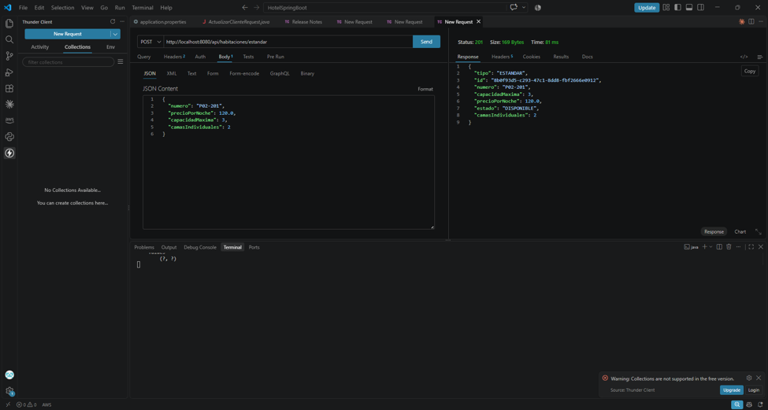
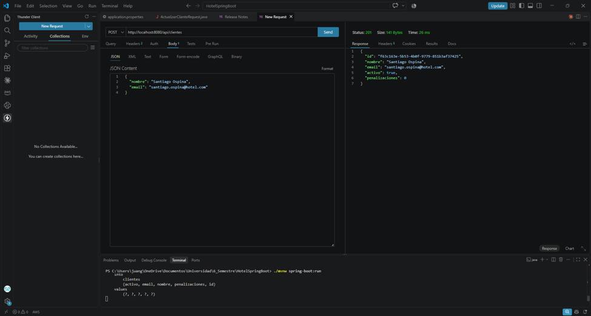
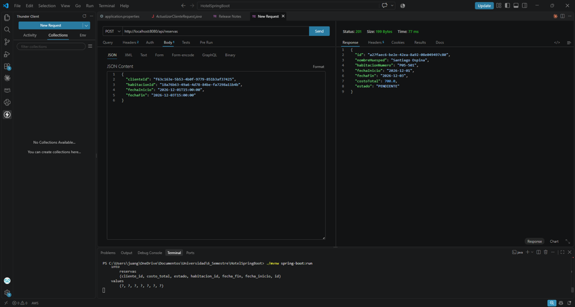
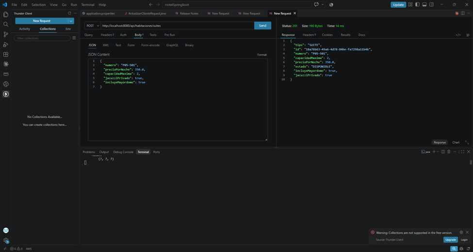
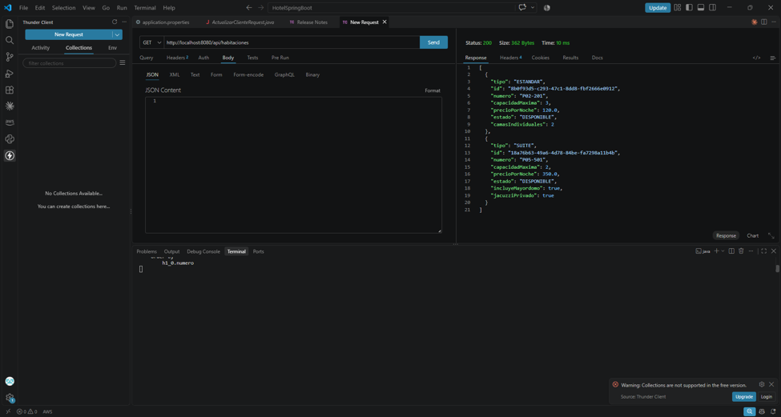
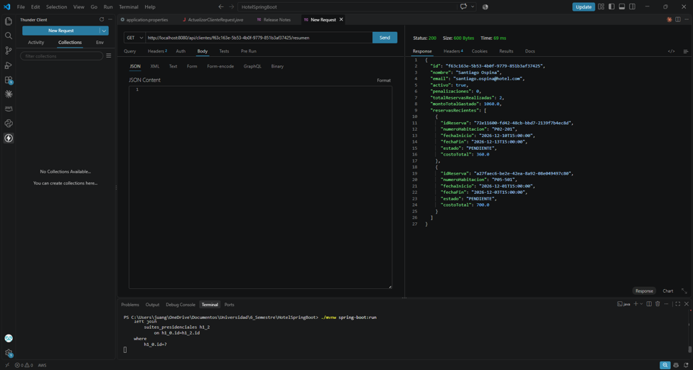
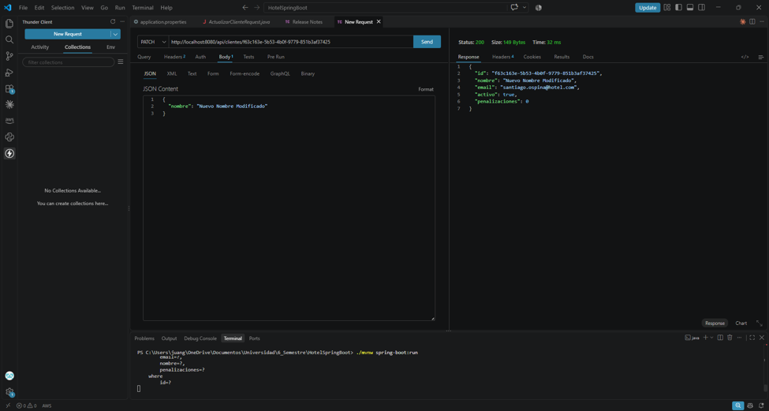
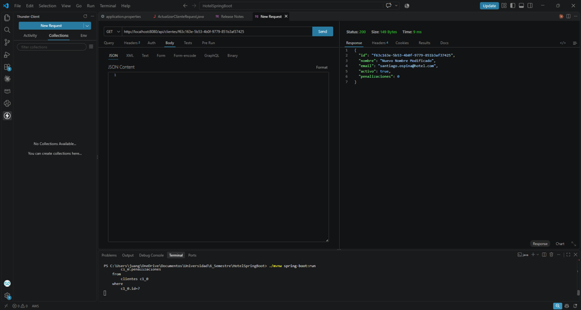
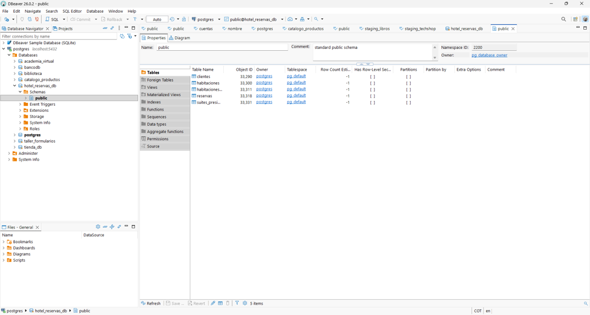

# Taller 7: Contratos Polimórficos, Proyecciones Anidadas y Actualización Parcial Segura

**Proyecto:** API REST del Hotel (Spring Boot 3.3.4 · Java 17 · PostgreSQL · MapStruct 1.5.5)
**Herramienta de pruebas:** Thunder Client (VS Code)

---

## Contenido

1. [Resumen de lo implementado](#1-resumen-de-lo-implementado)
2. [Endpoints de la API](#2-endpoints-de-la-api)
3. [Preparación de datos](#3-preparación-de-datos)
4. [Prueba 1: Creación de Suite Presidencial](#4-prueba-1-creación-de-suite-presidencial)
5. [Prueba 2: Consulta polimórfica](#5-prueba-2-consulta-polimórfica)
6. [Prueba 3: Resumen ejecutivo del cliente](#6-prueba-3-resumen-ejecutivo-del-cliente)
7. [Prueba 4: Actualización selectiva (PATCH)](#7-prueba-4-actualización-selectiva-patch)
8. [Base de datos PostgreSQL](#8-base-de-datos-postgresql)
9. [Cumplimiento de la rúbrica](#9-cumplimiento-de-la-rúbrica)
10. [Cómo ejecutar el proyecto](#10-cómo-ejecutar-el-proyecto)

---

## 1. Resumen de lo implementado

| Tarea | Archivos principales |
|---|---|
| **1. Polimorfismo en la API** | `dto/request/CrearHabitacionEstandarRequest`, `dto/request/CrearSuitePresidencialRequest`, `dto/response/HabitacionResponse` (sealed interface), `HabitacionEstandarResponse`, `SuitePresidencialResponse`, `mapper/HabitacionMapper`, `service/HabitacionService`, `controller/HabitacionController` |
| **2. Proyecciones anidadas** | `dto/response/ClienteResumenResponse`, `dto/response/ReservaItemResponse`, `mapper/ClienteMapper` (`toResumenResponse`), `mapper/ReservaMapper` (`toItemResponse`) |
| **3. PATCH seguro** | `dto/request/ActualizarClienteRequest`, `mapper/ClienteMapper` (`updateClienteFromDto`), `service/ClienteService` (`actualizarParcial`), `controller/ClienteController` |
| **Manejo de errores** | `exception/ManejadorGlobalErrores`, `exception/RecursoNoEncontradoException` |

---

## 2. Endpoints de la API

| Verbo | Ruta | Descripción | Código de éxito |
|---|---|---|---|
| `POST` | `/api/habitaciones/estandar` | Crear habitación estándar | **201 Created** |
| `POST` | `/api/habitaciones/suites` | Crear suite presidencial | **201 Created** |
| `GET` | `/api/habitaciones` | Listado polimórfico con discriminador `tipo` | **200 OK** |
| `POST` | `/api/clientes` | Registrar cliente | **201 Created** |
| `GET` | `/api/clientes/{id}` | Consultar cliente | **200 OK** |
| `GET` | `/api/clientes/{id}/resumen` | Resumen ejecutivo con historial de reservas | **200 OK** |
| `PATCH` | `/api/clientes/{id}` | Actualización parcial de nombre y/o email | **200 OK** |
| `POST` | `/api/reservas` | Crear reserva | **201 Created** |

Errores controlados: **400** (datos inválidos), **404** (recurso no encontrado), **409** (número de habitación o email duplicado).

---

## 3. Preparación de datos

Antes de las pruebas del taller se crearon una habitación estándar, un cliente y dos reservas, para tener datos que consultar.

### 3.1 Habitación estándar

`POST /api/habitaciones/estandar` → **201 Created**. La respuesta incluye `"tipo": "ESTANDAR"` y el atributo propio `camasIndividuales`.



### 3.2 Cliente

`POST /api/clientes` → **201 Created**. El cliente nace con `activo: true` y `penalizaciones: 0`, valores definidos por el constructor del dominio.



### 3.3 Reservas

Se crearon dos reservas para el mismo cliente. El costo total lo calcula la entidad `Reserva`:

| Habitación | Noches | Precio/noche | Costo total |
|---|---|---|---|
| P05-501 (Suite) | 2 (01-dic → 03-dic) | 350.0 | **700.0** |
| P02-201 (Estándar) | 3 (10-dic → 13-dic) | 120.0 | **360.0** |




---

## 4. Prueba 1: Creación de Suite Presidencial

**Petición:**

```http
POST http://localhost:8080/api/habitaciones/suites
Content-Type: application/json

{
  "numero": "P05-501",
  "precioPorNoche": 350.0,
  "capacidadMaxima": 2,
  "jacuzziPrivado": true,
  "incluyeMayordomo": true
}
```

**Resultado esperado:** `201 Created` con el ID generado. ✅



**Cómo funciona:**

- La suite tiene su propio DTO de entrada (`CrearSuitePresidencialRequest`), así que no se mezcla con los campos de la habitación estándar.
- `HabitacionMapper.toEntity(...)` usa el **constructor del dominio** `SuitePresidencial(...)`, de modo que se respetan sus validaciones (número obligatorio, capacidad mínima, precio no negativo).
- El controlador responde **201 Created** con la cabecera `Location` apuntando al nuevo recurso.

---

## 5. Prueba 2: Consulta polimórfica

**Petición:**

```http
GET http://localhost:8080/api/habitaciones
```

**Resultado esperado:** un arreglo JSON donde conviven habitaciones estándar y suites, cada una con sus campos propios y sin errores de casteo. ✅



**Cómo funciona:**

1. **Herencia JOINED:** `findAll` sobre la clase abstracta `Habitacion` hace que Hibernate una las tablas `habitaciones`, `habitaciones_estandar` y `suites_presidenciales`, y devuelva instancias concretas.
2. **MapStruct polimórfico:** `HabitacionMapper.toResponse(Habitacion)` usa `@SubclassMapping`. MapStruct genera un `instanceof` por cada subclase y delega en el método específico, sin perder `camasIndividuales` ni `jacuzziPrivado`/`incluyeMayordomo`:

   ```java
   @SubclassMapping(source = HabitacionEstandar.class, target = HabitacionEstandarResponse.class)
   @SubclassMapping(source = SuitePresidencial.class, target = SuitePresidencialResponse.class)
   HabitacionResponse toResponse(Habitacion habitacion);
   ```

3. **Contrato sellado:** `HabitacionResponse` es una `sealed interface` de Java 17 que solo permite sus dos implementaciones. Con `@JsonTypeInfo` y `@JsonSubTypes`, Jackson agrega el discriminador `"tipo": "ESTANDAR"` o `"tipo": "SUITE"` a cada elemento.

---

## 6. Prueba 3: Resumen ejecutivo del cliente

**Petición:**

```http
GET http://localhost:8080/api/clientes/f63c163e-5b53-4b0f-9779-851b3af37425/resumen
```

**Resultado esperado:** total gastado calculado, cantidad de reservas y la lista embebida limpia, sin recursión infinita ni `$ref` cíclicos. ✅



**Valores obtenidos:**

| Campo | Valor | Cálculo |
|---|---|---|
| `totalReservasRealizadas` | **2** | `cliente.getReservas().size()` |
| `montoTotalGastado` | **1060.0** | 700.0 + 360.0, sumado con Java Streams |
| `reservasRecientes` | 2 elementos | De la más reciente a la más antigua, **sin referencia al cliente** |

**Cómo funciona:**

```java
@Mapping(target = "totalReservasRealizadas", expression = "java(cliente.getReservas().size())")
@Mapping(target = "montoTotalGastado", source = "reservas", qualifiedByName = "calcularMontoTotal")
@Mapping(target = "reservasRecientes", source = "reservas", qualifiedByName = "ordenarRecientes")
ClienteResumenResponse toResumenResponse(Cliente cliente);

@Named("calcularMontoTotal")
default double calcularMontoTotal(List<Reserva> reservas) {
    return reservas.stream()
            .mapToDouble(Reserva::getCostoTotal)
            .sum();
}
```

- **Sin recursión infinita:** `ReservaItemResponse` solo contiene `idReserva`, `numeroHabitacion`, `fechaInicio`, `fechaFin`, `estado` y `costoTotal`. **No referencia al cliente**, por lo que el ciclo `Cliente → Reservas → Cliente` nunca se forma al serializar con Jackson.
- **Sin `@Entity` en la capa web:** el mapeo ocurre dentro de la transacción del servicio (`@Transactional(readOnly = true)`) y el controlador solo recibe DTOs.

---

## 7. Prueba 4: Actualización selectiva (PATCH)

### 7.1 Envío solo del nombre

**Petición:**

```http
PATCH http://localhost:8080/api/clientes/f63c163e-5b53-4b0f-9779-851b3af37425
Content-Type: application/json

{
  "nombre": "Nuevo Nombre Modificado"
}
```

**Resultado esperado:** `200 OK` con el `ClienteResponse` actualizado. ✅



### 7.2 Verificación desde la base de datos

```http
GET http://localhost:8080/api/clientes/f63c163e-5b53-4b0f-9779-851b3af37425
```



| Campo | Antes | Después del PATCH |
|---|---|---|
| `nombre` | Santiago Ospina | **Nuevo Nombre Modificado** ✏️ |
| `email` | santiago.ospina@hotel.com | santiago.ospina@hotel.com ✅ sin cambios |
| `activo` | true | true ✅ sin cambios |
| `penalizaciones` | 0 | 0 ✅ sin cambios |

**Cómo funciona:**

```java
@BeanMapping(nullValuePropertyMappingStrategy = NullValuePropertyMappingStrategy.IGNORE)
@Mapping(target = "id", ignore = true)
@Mapping(target = "activo", ignore = true)
@Mapping(target = "penalizaciones", ignore = true)
@Mapping(target = "reservas", ignore = true)
void updateClienteFromDto(ActualizarClienteRequest dto, @MappingTarget Cliente entity);
```

- **`NullValuePropertyMappingStrategy.IGNORE`:** como no se envió `email`, llegó como `null`, y MapStruct **no lo sobrescribe**. El código generado solo asigna los campos que no son nulos (`if (dto.nombre() != null) entity.setNombre(...)`).
- **Protección contra Mass Assignment:** `ActualizarClienteRequest` solo expone `nombre` y `email`. Además, `id`, `activo`, `penalizaciones` y `reservas` se ignoran explícitamente en el mapper, y la entidad `Cliente` no tiene setters para ellos.
- **Flujo del servicio:** (1) cargar la entidad desde la BD → (2) aplicar el mapper → (3) guardar y retornar `ClienteResponse` con **200 OK**.

---

## 8. Base de datos PostgreSQL

Las tablas generadas en `hotel_reservas_db` reflejan la herencia **JOINED**: una tabla padre `habitaciones` y una tabla por cada subclase (`habitaciones_estandar`, `suites_presidenciales`), unidas por el mismo `id`.



---

## 9. Cumplimiento de la rúbrica

| Criterio | Peso | Evidencia |
|---|---|---|
| **Mapeo polimórfico** | 30% | `@SubclassMapping` en `HabitacionMapper`, sealed interface `HabitacionResponse` con discriminador `tipo`, DTOs de entrada separados. Pruebas 1 y 2. |
| **Mapeo de colecciones y agregados** | 25% | `ClienteResumenResponse` con `@Named` y Java Streams, y `ReservaItemResponse` sin referencia al cliente. Prueba 3. |
| **Actualización parcial inmune** | 25% | `@MappingTarget` con `NullValuePropertyMappingStrategy.IGNORE` y campos sensibles ignorados. Prueba 4. |
| **Semántica y contratos HTTP** | 20% | `201` en creaciones, `200` en consultas y PATCH, verbos `POST`/`GET`/`PATCH`, y solo DTOs en los controladores (ninguna `@Entity` en la capa web). |

### Prueba automática

El proyecto incluye `src/test/java/com/hotel/Hotel/Taller7IntegrationTest.java`, que ejecuta automáticamente las 4 pruebas del taller contra una base de datos H2 en memoria. También verifica que un intento de enviar `{"activo": false, "penalizaciones": 99}` en el PATCH **no modifica** esos campos.

```bash
./mvnw test
```

---

## 10. Cómo ejecutar el proyecto

1. Crear la base de datos en PostgreSQL:
   ```sql
   CREATE DATABASE hotel_reservas_db;
   ```
2. Configurar el usuario y la contraseña en `src/main/resources/application.properties`.
3. Iniciar la API:
   ```bash
   ./mvnw spring-boot:run
   ```
4. Ejecutar las peticiones de `solicitudes-avanzadas.http` (extensión REST Client) o crearlas en Thunder Client siguiendo este documento.

> **Nota sobre `RangoFechas`:** Hibernate 6 entrega los componentes de un `record` embebible en orden alfabético (`fechaFin`, `fechaInicio`), lo que invertía las fechas al leer las reservas y hacía fallar la validación del record. Se corrigió con `domain/RangoFechasInstantiator`, registrado mediante `@EmbeddableInstantiator`.
